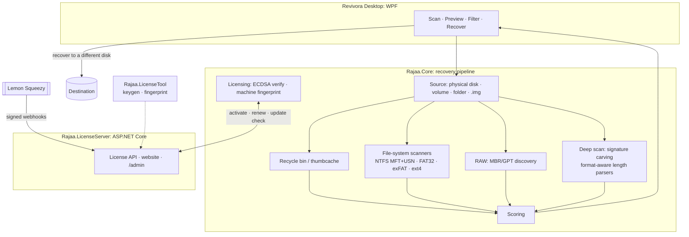

# Revivora: Deleted File & Photo Recovery for Windows

**A commercial .NET data-recovery product. It recovers deleted photos, videos and documents from drives, partitions, disk images or folders. It has a multi-layer recovery engine, a WPF desktop app and its own licensing and payments server.**


> **Status:** This product is in active development. The source is private, and I can walk you through it on request.

---

## 🧩 Problem → Solution

**Problem:** People lose irreplaceable photos and files to accidental deletion, formatting or a broken partition. Many recovery tools are opaque, overwrite the source, or stop at a fixed file size and return corrupted files.

**Solution:** Revivora treats the source as **strictly read-only**. It combines several recovery layers, from file-system metadata to deep signature carving, and it **scores the quality** of every result. Users scan and preview first, then recover only the files they choose to a different drive.

## ✨ Key features

**Recovery engine (`Rajaa.Core`)**
1. **Recycle bin and trash:** Windows `$Recycle.Bin` and the Linux trash.
2. **Windows thumbnail cache:** previews of deleted photos rebuilt from `thumbcache_*.db`.
3. **Deleted file names:** NTFS MFT (with USN journal hints), FAT32, exFAT, and ext4 (partial, via debugfs).
4. **RAW volumes:** MBR/GPT partition discovery, without ever modifying the partition table.
5. **Deep scan:** cluster-aligned signature carving across all free space from `$Bitmap`. It covers the whole disk and tries all file types in a single pass.
6. **Disk imaging:** read-only RAW/DD images, so you can scan a copy instead of the failing disk.
7. **Scoring:** results are graded excellent, good, fair, poor or overwritten.

- **Format-aware carving:** each type has a parser that computes the file's real length from its internal structure. Supported formats include JPEG (including progressive), PNG, HEIC/AVIF, camera RAW (CR2/NEF/ARW/DNG), MP4/MOV/MKV, MP3/FLAC/Opus, PDF/Office, ZIP/RAR/7z and SQLite.
- **Desktop UX (WPF):** drive and volume picker, thumbnail previews, search and filters (name, type, size, score, source), progress with ETA and pause, saved scan sessions, and admin elevation only when needed.
- **Safety:** temp files are kept off the source disk, and you're warned if the source and destination are the same disk. The app is also honest that SSD/TRIM can make recovery impossible.

**Commercial platform (`Rajaa.LicenseServer`)**
- An Arabic/English product website with pricing, legal pages, SEO (sitemap, hreflang, JSON-LD), downloads and activation.
- **Free, monthly and lifetime editions** built from one codebase at publish time.
- Hardware-bound licenses **signed with ECDSA P-256**, verified offline, and protected against clock rollback with an HMAC-stamped state.
- **Lemon Squeezy webhooks** for orders, refunds and the full subscription lifecycle. Monthly keys auto-renew from the server.
- An update check and an admin page for purchase codes.

## 🏗️ Architecture



## 🧰 Tech stack

| Area | Technologies |
|---|---|
| Engine | .NET 8, low-level disk I/O, NTFS/FAT/exFAT parsing, ImageSharp |
| Desktop | WPF (Windows) |
| Server | ASP.NET Core: website, license API, payment webhooks |
| Security | ECDSA P-256 signing, HMAC anti-rollback, Authenticode signing hooks |
| Testing | xUnit, test disk images and recovery-quality benchmarks |

## 📁 Solution structure

```text
Rajaa.sln
├── src/Rajaa.Core            Recovery engine: pipeline, NTFS, carving, scoring, licensing
├── src/Rajaa.Desktop         WPF desktop app (the only UI)
├── src/Rajaa.LicenseServer   Website, license server and payment webhook
├── tools/Rajaa.LicenseTool   Machine fingerprint and signing-key generation
└── tests/Rajaa.Tests         Tests and benchmarks
```

## 🧠 Design decisions

- **The source is read-only.** Writes only ever go to the destination.
- **Correctness before features.** The priority order is recovery correctness, then safety, performance, trust/UX, packaging and payments. Licensing was only added after the engine was stable on test images.
- **An `IFileSystemScanner` abstraction** makes it easy to add new file systems.
- **Scan and recover are separate steps**, which is also the basis of the freemium model.
- **Offline-verifiable licenses.** The app ships only the public key. The license type comes from the payment provider's variant ID, never from the client.
- **Iterative delivery** in sprints: understand, stabilize, refactor, extend, with no blind rewrites.

## 🗺️ Roadmap

| Sprint | Scope | Status |
|---|---|---|
| 1 | Product foundation: volume discovery, scan/recover split, same-disk warning | ✅ |
| 2 | Previews, filters, rich progress, saved sessions | ✅ |
| 3 | FAT32/exFAT, more signatures, test images and quality metrics | ✅ |
| 4 | RAW volumes, MBR/GPT discovery, disk imaging, admin isolation | ✅ |
| 5 | Commercial: installer, licensing, website, payments, plans | ✅ (domain and store setup pending) |
| 6 | Recovery quality, new formats, thumbcache, protection, update checks | ✅ |
| Next | Real-hardware benchmarks (USB/SSD/HDD), fragmented JPEG repair, code-signing cert, launch | ⏳ |

## 👤 Author

**Ahmed Helmy**, Senior .NET & Full-Stack Developer  
[ahmed.helmy.seleem96@gmail.com](mailto:ahmed.helmy.seleem96@gmail.com) · [LinkedIn](https://www.linkedin.com/in/ahmed-helmy-071a78207) · [GitHub](https://github.com/AhmedHelmySeleem96)
